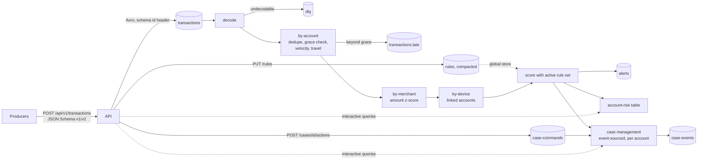

# fraudstream

[English](README.md) | [Português (Brasil)](README.pt-BR.md)

[](https://github.com/FrancisWorld/fraudstream/actions/workflows/ci.yml)
[](LICENSE)

Real-time fraud detection on Kafka Streams (Java 21): event-time velocity windows, impossible travel, merchant anomalies, a device graph, rules you can hot-reload, exactly-once processing, and a case-management API, with a backtest CLI that measures precision and recall on synthetic data.

## Why this exists, and what is hard about it

Fraud scoring looks like "evaluate some rules per transaction". The interesting problems are all around that:

- **Time.** Payments arrive late and out of order. Velocity must be measured in *event time*, a late event must not silently corrupt a window, and "too late" needs an explicit, observable policy (here: a grace period, and a dedicated late-events topic).
- **State that spans keys.** Velocity is per account, merchant baselines are per merchant, the device graph is per device. One transaction therefore crosses three partitionings, which means repartition topics and careful state design.
- **Change without redeploy.** Analysts change rules daily. The rule set is a versioned, validated DSL broadcast to every instance through a global store, with stale and invalid versions rejected.
- **Correctness under failure.** Redelivery, duplicates, poison records and two analysts clicking "claim" at once must all end in a consistent state.
- **Evolution.** Producers upgrade at different speeds, so the wire format carries two live schema generations.

## Architecture



| Concern | Where |
|---|---|
| Wire format, schema generations | `schema/`, `src/main/resources/schemas/` |
| Rule DSL (lexer, parser, type checker, engine) | `rules/` |
| Feature logic (pure, no Kafka types) | `features/` |
| Topology and processors | `topology/` |
| Case state machine | `cases/` |
| HTTP API, auth, owner forwarding | `api/`, `query/` |
| Backtest, generator, replay | `cli/` |

## Quickstart

Requirements: JDK 21, Maven. Docker is only needed for the compose stack and the opt-in smoke test.

```sh
mvn -B verify                       # lint (spotless), compile with -Werror, 187 tests, 85% coverage gate

mvn -B -q package -DskipTests
scripts/fraudstream-cli generate --accounts 500 --days 14 --seed 42 --out data.jsonl
scripts/fraudstream-cli backtest --data data.jsonl --json report.json
```

Run the whole stack (Kafka KRaft, the service):

```sh
sh scripts/gen-env.sh               # writes .env with random demo tokens and their SHA-256 hashes
docker compose up -d --build        # add --profile observability for Prometheus and Grafana
. ./.env
curl -s localhost:8081/readyz       # {"status":"ready"}

scripts/fraudstream-cli replay --data data.jsonl --limit 700     # uses FRAUDSTREAM_INGEST_TOKEN
curl -s -H "Authorization: Bearer $FRAUDSTREAM_ANALYST_TOKEN" 'localhost:8080/api/v1/cases?limit=1'
curl -s -X POST -H "Authorization: Bearer $FRAUDSTREAM_ANALYST_TOKEN" \
     -d '{"type":"CLAIM"}' localhost:8080/api/v1/cases/acct-0100-1/actions
```

If port 8080 or 8081 is taken, set `FRAUDSTREAM_API_PORT` / `FRAUDSTREAM_MANAGEMENT_PORT` in `.env`.

### HTTP API

| Method and path | Role | Notes |
|---|---|---|
| `POST /api/v1/transactions` | ingest | validated against JSON Schema v1 or v2, `202` with partition and offset |
| `PUT /api/v1/rules`, `POST /api/v1/rules/validate` | admin | `422` lists every DSL error, `409` if the version is not higher |
| `GET /api/v1/rules` | analyst | active rule set |
| `GET /api/v1/accounts/{id}/risk` | analyst | interactive query on the `account-risk` table |
| `GET /api/v1/devices/{id}/accounts` | analyst | accounts linked to a device |
| `GET /api/v1/cases?status=&assignee=&accountId=&limit=` | analyst | fans out to every instance |
| `GET /api/v1/cases/{id}`, `POST /api/v1/cases/{id}/actions` | analyst | actions: `CLAIM`, `RELEASE`, `CONFIRM_FRAUD`, `DISMISS`, `COMMENT` |

Management port (`8081`): `/healthz`, `/readyz`, `/metrics` (Prometheus), unauthenticated, keep it off public networks.

### Sample output

Real output of the commands above on an Apple Silicon laptop (8 GB), 500 accounts, 14 days, seed 42:

```text
SYNTHETIC DATA: invented transactions with injected fraud patterns. These figures say how the rules behave on this generator, not how they would perform on real fraud.

rule set version      : 1
transactions          : 9684 (68 fraudulent, 25 episodes)
alerted transactions  : 114  (late: 0, dead-lettered: 0)
precision             : 0.377
recall (transaction)  : 0.632
recall (episode)      : 0.880
F1                    : 0.473
false alerts / 1000 legit: 7.38
confusion             : tp=43 fp=71 fn=25 tn=9545

per pattern (episodes detected / total, fraud txns flagged / total)
  device_ring          5 / 5       17 / 23
  impossible_travel    8 / 8        8 / 8
  low_and_slow         2 / 5        6 / 15
  merchant_anomaly     5 / 5        5 / 5
  velocity_burst       2 / 2        7 / 17

per rule (hits, precision)
  high-hourly-spend              3   1.000
  impossible-travel             10   0.800
  merchant-amount-anomaly       67   0.433
  shared-device                 13   1.000
  velocity-burst                38   0.184

replayed in 6.3s (1533 txn/s)
```

How to read it: these numbers describe how the *shipped example rules* behave on *this generator*. The generator includes legitimate shopping sprees and big one-off purchases that trip the velocity and merchant rules (hence the low precision of those two), and a "low and slow" pattern that no rule targets (so it is mostly missed). Transaction-level recall is lower than episode recall because a velocity burst is only flagged from its sixth transaction. Nothing here is a claim about real fraud. The throughput figure is the in-process test-driver replay (RocksDB state, JSON serdes, no network) on that one machine; it is not a service benchmark.

Replaying 684 of those transactions through the running compose stack and asking the API:

```text
sent=684 accepted=684 rejected=0 failed=0
$ curl -H "Authorization: Bearer $ANALYST" localhost:8080/api/v1/cases/acct-0100-1/actions -d '{"type":"CLAIM"}'
{"actor":"analyst-1","caseId":"acct-0100-1","commandId":"ed9b6887-...","replayed":false}
$ curl .../cases/acct-0100-1   ->  IN_REVIEW analyst-1 ['CASE_OPENED', 'CLAIMED']
$ curl .../metrics | grep fraudstream_alerts_total   ->  fraudstream_alerts_total 8.0
```

## Design decisions and trade-offs

- **Processor API for the stateful stages, DSL for the plumbing.** Windowed DSL aggregations drop late records silently. Keeping an event-time-ordered buffer per account lets velocity be *exact* (a sliding window ending at the event's own time, verified against a brute-force oracle with jqwik), makes duplicates detectable, and lets late events be routed to a topic instead of vanishing. The cost is that state is JSON per account, bounded to 2,000 events, rewritten on each event.
- **Scoring is immediate, so scores depend on arrival order within grace.** An event is scored once, on arrival, over the events ingested before it, in a window ending at its own timestamp. The *stored state* is independent of arrival order (property-tested), and a late arrival's own features are exact, but an alert already emitted for a newer event is not revised or retracted when an older event arrives afterwards. The alternative, holding every event until its grace closes, would make scores order-independent and delay every alert by the grace period; I chose latency.
- **Grace uses Kafka Streams stream time.** An event is late when `eventTime < streamTime - grace`, where stream time is the maximum event time seen by that partition's task. This matches Kafka's own window-closing semantics; a very active account therefore advances the clock for every account on its partition.
- **Three repartition hops** (account, merchant, device) instead of a co-partitioned join: simple, each stage owns one store, and the features of a transaction come from state keyed the way that feature needs. Every hop re-keys defensively, so correctness does not depend on how producers key records.
- **Rule hot reload through a global store.** Every instance holds the full rule set. A rule set applies only if it compiles and its version is strictly higher, so stale redelivery and broken rules are ignored (and counted). Reload is eventually consistent across instances and not transactional with scoring, so every alert records the `ruleSetVersion` that produced it.
- **A purpose-built DSL, not an embedded scripting language.** Expressions are bounded (2,000 characters, nesting depth 32, 500 terms, 50 items per `in` list) and rejected with a column otherwise, so a hostile rule set cannot exhaust the stack or CPU. A small typed grammar (numbers, strings, booleans, `in`, arithmetic, `and`/`or`/`not`) over a closed variable catalogue. Type errors and unknown variables are reported with a column at publish time, nothing is executed that is not in the grammar, and a rule that fails at runtime (division by zero) is skipped and counted rather than failing the stream.
- **Event-sourced cases inside Kafka Streams.** Alerts and analyst commands are merged into one stream keyed by account, so the partition serialises them: two racing `CLAIM`s have exactly one winner and the loser gets a `COMMAND_REJECTED` event. Commands carry an idempotency id. The API pre-checks the transition for fast feedback (`409`), but the topology is the authority. No external database, at the price that listing cases scans the store (there is no secondary index). Per account, all open cases and the 20 most recent closed ones are retained; older closed cases are evicted from state (their history stays in the `case-events` topic) and case ids are never reused.
- **Interactive queries with owner forwarding.** Keyed requests are proxied to the instance that owns the key (one hop only; a forwarded request is never forwarded again). The hop is authenticated with an HMAC-SHA256 over method, path, query and timestamp under `FRAUDSTREAM_PEER_SECRET`; a client-supplied hop header without a valid signature is ignored. Every instance of a multi-instance deployment must share the secret; if it is unset a random one is generated, which is fine for a single instance only, list requests fan out and mark the result `partial` if a peer is down.
- **Wire format.** `[0x00][schema id][Avro binary]` with two schema generations resolved to the latest on read (`SchemaCompatibility` is asserted both ways in tests). There is no external schema registry: the registry is the classpath, which is enough for one service but would not suit many independent producers. The HTTP edge validates JSON Schema v1/v2 and writes the generation the caller used.
- **Auth.** Bearer tokens are configured as SHA-256 hashes (so config leaks are not usable tokens), compared in constant time, mapped to roles (`INGEST`, `ANALYST`, `ADMIN`). The service refuses to start without tokens. The actor recorded in a case's audit trail is the authenticated principal; a spoofed `actor` in a request body is ignored (tested).
- **Exactly-once v2** is enabled for the streams application and the API producer is idempotent with `acks=all`. Duplicates from at-least-once producers are removed by the topology (transaction id, within one hour plus grace).

## Testing strategy

187 tests, run by `mvn verify`, no broker needed except the opt-in smoke test. Line coverage is 92.7% overall and the build fails below 85%.

- **TopologyTestDriver with RocksDB state** for the pipeline: every feature end to end, grace boundaries, out-of-order inside grace, duplicates, poison records of four kinds, both schema generations, rule hot reload, stale and invalid rule sets, runtime rule errors, the case lifecycle, idempotent commands, the lost-race claim.
- **jqwik properties:** velocity equals a brute-force oracle; final state independent of arrival order; replay idempotent; windows monotone; DSL `format`/`parse` fixed point, De Morgan, arithmetic against Java; Avro round trip for arbitrary transactions; case state machine never reopens a closed case; haversine symmetry.
- **Real HTTP, real routes, real topology:** the API tests drive an `HttpServer` over a mock producer whose records are piped into the topology, covering auth (401/403), validation (422), size limits (413), broker failure (503), the full alert-to-case flow, and two API instances forwarding to each other.
- **Backtest tests** check generator determinism, reproducibility, that disorder beyond grace creates late events and lowers recall, and exact precision/recall arithmetic.
- **Smoke test (`KafkaSmokeIT`, opt-in):** `mvn verify -Psmoke` starts `apache/kafka-native` with Testcontainers (or uses `FRAUDSTREAM_SMOKE_BOOTSTRAP`), starts the real application, ingests through HTTP, and checks the alert in a `read_committed` consumer, including redelivery. On Colima set `DOCKER_HOST=unix://$HOME/.colima/default/docker.sock` and `TESTCONTAINERS_RYUK_DISABLED=true`. I ran it once on the same laptop and it passed in about 26 seconds.

A caveat about the test driver: it runs all sub-topologies in one task, so stream time is shared across the whole topology. Test commands are therefore stamped inside the event timeline. In a real deployment each sub-topology has its own stream time.

## Limitations (read these)

- Never run as a production system. The rules and thresholds are examples; the dataset is invented.
- **Not verified:** the Prometheus and Grafana profile (config files validated by eye only, images not pulled); the OpenTofu stack is only `fmt`/`validate`d, never planned or applied, so MSK Serverless IAM permissions, the `msk` build profile (`-Pmsk`, adds `aws-msk-iam-auth`) and Fargate behaviour are untested; multi-instance Kafka Streams rebalancing and cross-instance forwarding were exercised with two in-process API instances, not two real Streams instances.
- The Docker image was built with the classic builder because `buildx` was not available on the build machine; the Dockerfile has no BuildKit-only syntax.
- Per-account state is serialised as JSON on every event; fine for card-like volumes, not for very hot keys.
- Late events are routed, not re-scored, and an out-of-order arrival within grace does not revise scores already emitted. Alerts are not retracted when a rule set changes.
- The case list scans local stores. The HTTP between instances is plain; terminate TLS in front of it and keep instance-to-instance traffic on a private network.
- Duplicate detection only covers the retention window (one hour plus grace).

## Key cardinality and retention

State grows with the number of distinct keys, and nothing here expires keys by time: one small record per account (at most 2,000 recent events), per merchant (a running mean and variance) and per device (at most 1,000 linked accounts, pruned to the 24-hour device window when the device is next seen). Idle merchants and devices are never removed, and an account's record is only pruned when that account transacts again. With millions of distinct devices or merchants plan the RocksDB and changelog disk accordingly, or add a TTL punctuator. Cases are retained as described above.

## Infrastructure

`infra/` is OpenTofu for MSK Serverless (IAM auth), an ECS Fargate service behind an internal ALB, a task role limited to this cluster's `fraud.*` and `<application-id>-*` topics, its own consumer group and `<application-id>-*` transactional ids, and a separate execution role that may read only the token secret. Validate only:

```sh
cd infra && tofu fmt -check && tofu init -backend=false && tofu validate
```

## License

MIT, see [LICENSE](LICENSE).

---

Built by [Chico Oliveira](https://github.com/FrancisWorld)
