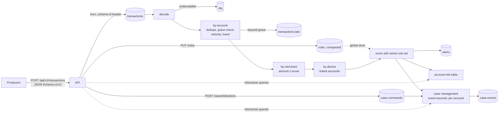

# fraudstream

[English](README.md) | [Português (Brasil)](README.pt-BR.md)

[](https://github.com/FrancisWorld/fraudstream/actions/workflows/ci.yml)
[](LICENSE)

Detecção de fraude em tempo real com Kafka Streams (Java 21): janelas de velocidade em tempo de evento, viagem impossível, anomalia de comerciante, grafo de dispositivos, regras com recarga a quente, processamento exactly-once e uma API de gestão de casos, com uma CLI de backtest que mede precisão e recall em dados sintéticos.

## Por que existe e o que é difícil

Pontuar fraude parece "avaliar regras por transação". Os problemas interessantes estão ao redor:

- **Tempo.** Pagamentos chegam atrasados e fora de ordem. A velocidade precisa ser medida em *tempo de evento*, um evento atrasado não pode corromper uma janela em silêncio, e "tarde demais" exige uma política explícita e observável (aqui: período de tolerância e um tópico próprio de eventos atrasados).
- **Estado que cruza chaves.** Velocidade é por conta, a linha de base é por comerciante, o grafo é por dispositivo. Uma transação atravessa três particionamentos: tópicos de repartição e desenho cuidadoso de estado.
- **Mudar sem redeploy.** Analistas mudam regras todo dia. O conjunto de regras é uma DSL versionada e validada, distribuída a todas as instâncias por um store global; versões antigas ou inválidas são rejeitadas.
- **Correção sob falha.** Reentrega, duplicatas, mensagens venenosas e dois analistas clicando em "assumir" ao mesmo tempo precisam terminar em estado consistente.
- **Evolução.** Produtores atualizam em ritmos diferentes, então o formato carrega duas gerações de schema vivas.

## Arquitetura



| Assunto | Onde |
|---|---|
| Formato de fio, gerações de schema | `schema/`, `src/main/resources/schemas/` |
| DSL de regras (léxico, parser, checagem de tipos, motor) | `rules/` |
| Lógica de features (pura, sem tipos Kafka) | `features/` |
| Topologia e processadores | `topology/` |
| Máquina de estados dos casos | `cases/` |
| API HTTP, autenticação, encaminhamento ao dono da chave | `api/`, `query/` |
| Backtest, gerador, replay | `cli/` |

## Início rápido

Requisitos: JDK 21 e Maven. Docker só é necessário para a stack compose e para o teste de fumaça opcional.

```sh
mvn -B verify                       # lint (spotless), compilação com -Werror, 187 testes, piso de 85% de cobertura

mvn -B -q package -DskipTests
scripts/fraudstream-cli generate --accounts 500 --days 14 --seed 42 --out data.jsonl
scripts/fraudstream-cli backtest --data data.jsonl --json report.json
```

Stack completa (Kafka KRaft e o serviço):

```sh
sh scripts/gen-env.sh               # grava .env com tokens de demonstração aleatórios e seus hashes SHA-256
docker compose up -d --build        # com --profile observability sobem Prometheus e Grafana
. ./.env
curl -s localhost:8081/readyz       # {"status":"ready"}

scripts/fraudstream-cli replay --data data.jsonl --limit 700     # usa FRAUDSTREAM_INGEST_TOKEN
curl -s -H "Authorization: Bearer $FRAUDSTREAM_ANALYST_TOKEN" 'localhost:8080/api/v1/cases?limit=1'
curl -s -X POST -H "Authorization: Bearer $FRAUDSTREAM_ANALYST_TOKEN" \
     -d '{"type":"CLAIM"}' localhost:8080/api/v1/cases/acct-0100-1/actions
```

Se as portas 8080 ou 8081 estiverem ocupadas, defina `FRAUDSTREAM_API_PORT` / `FRAUDSTREAM_MANAGEMENT_PORT` no `.env`.

### API HTTP

| Método e caminho | Papel | Observações |
|---|---|---|
| `POST /api/v1/transactions` | ingest | validado por JSON Schema v1 ou v2; `202` com partição e offset |
| `PUT /api/v1/rules`, `POST /api/v1/rules/validate` | admin | `422` lista todos os erros da DSL; `409` se a versão não for maior |
| `GET /api/v1/rules` | analista | conjunto de regras ativo |
| `GET /api/v1/accounts/{id}/risk` | analista | consulta interativa na tabela `account-risk` |
| `GET /api/v1/devices/{id}/accounts` | analista | contas ligadas a um dispositivo |
| `GET /api/v1/cases?status=&assignee=&accountId=&limit=` | analista | consulta todas as instâncias |
| `GET /api/v1/cases/{id}`, `POST /api/v1/cases/{id}/actions` | analista | ações: `CLAIM`, `RELEASE`, `CONFIRM_FRAUD`, `DISMISS`, `COMMENT` |

Porta de gestão (`8081`): `/healthz`, `/readyz`, `/metrics` (Prometheus), sem autenticação; não exponha em redes públicas.

### Saída real

Saída real dos comandos acima num notebook Apple Silicon (8 GB), 500 contas, 14 dias, seed 42:

```text
SYNTHETIC DATA: invented transactions with injected fraud patterns. These figures say how the rules behave on this generator, not how they would perform on real fraud.

rule set version      : 1
transactions          : 9684 (68 fraudulent, 25 episodes)
alerted transactions  : 114  (late: 0, dead-lettered: 0)
precision             : 0.377
recall (transaction)  : 0.632
recall (episode)      : 0.880
F1                    : 0.473
false alerts / 1000 legit: 7.38
confusion             : tp=43 fp=71 fn=25 tn=9545

per pattern (episodes detected / total, fraud txns flagged / total)
  device_ring          5 / 5       17 / 23
  impossible_travel    8 / 8        8 / 8
  low_and_slow         2 / 5        6 / 15
  merchant_anomaly     5 / 5        5 / 5
  velocity_burst       2 / 2        7 / 17

per rule (hits, precision)
  high-hourly-spend              3   1.000
  impossible-travel             10   0.800
  merchant-amount-anomaly       67   0.433
  shared-device                 13   1.000
  velocity-burst                38   0.184

replayed in 6.3s (1533 txn/s)
```

Como ler: os números descrevem o comportamento das *regras de exemplo* sobre *este gerador*. O gerador inclui rajadas legítimas de compras e compras grandes pontuais que disparam as regras de velocidade e de comerciante (por isso a precisão baixa dessas duas) e um padrão "devagar e sempre" que nenhuma regra cobre (quase sempre perdido). O recall por transação é menor que o por episódio porque uma rajada só é sinalizada a partir da sexta transação. Nada aqui afirma desempenho em fraude real. A vazão é do replay em processo com o test driver (estado RocksDB, serdes JSON, sem rede) naquela máquina; não é benchmark do serviço.

Reproduzindo 684 dessas transações na stack compose em execução e consultando a API:

```text
sent=684 accepted=684 rejected=0 failed=0
$ curl -H "Authorization: Bearer $ANALYST" localhost:8080/api/v1/cases/acct-0100-1/actions -d '{"type":"CLAIM"}'
{"actor":"analyst-1","caseId":"acct-0100-1","commandId":"ed9b6887-...","replayed":false}
$ curl .../cases/acct-0100-1   ->  IN_REVIEW analyst-1 ['CASE_OPENED', 'CLAIMED']
$ curl .../metrics | grep fraudstream_alerts_total   ->  fraudstream_alerts_total 8.0
```

## Decisões de projeto e trade-offs

- **Processor API nos estágios com estado, DSL na tubulação.** Agregações janeladas da DSL descartam registros atrasados em silêncio. Manter um buffer ordenado por tempo de evento por conta torna a velocidade *exata* (janela deslizante terminando no instante do próprio evento, conferida contra um oráculo de força bruta com jqwik), permite detectar duplicatas e rotear atrasados para um tópico. O custo: estado em JSON por conta, limitado a 2.000 eventos, regravado a cada evento.
- **O scoring é imediato, então o score depende da ordem de chegada dentro da tolerância.** Um evento é pontuado uma vez, na chegada, sobre os eventos já ingeridos, numa janela que termina no seu próprio instante. O *estado armazenado* independe da ordem de chegada (testado por propriedade) e as features de um evento atrasado são exatas, mas um alerta já emitido para um evento mais novo não é revisado nem retirado quando um evento mais antigo chega depois. A alternativa, reter cada evento até fechar a tolerância, deixaria os scores independentes da ordem ao custo de atrasar todo alerta pela tolerância; escolhi a latência.
- **A tolerância usa o stream time do Kafka Streams.** Um evento é atrasado quando `eventTime < streamTime - grace`, sendo stream time o maior tempo de evento visto pela tarefa da partição. É a mesma semântica de fechamento de janela do Kafka; uma conta muito ativa avança o relógio de todas as contas da partição.
- **Três saltos de repartição** (conta, comerciante, dispositivo) em vez de join co-particionado: simples, cada estágio é dono de um store e cada feature vem de estado chaveado como ela precisa. Cada salto re-chaveia por segurança, então a correção não depende de como os produtores chaveiam.
- **Recarga a quente via store global.** Toda instância tem o conjunto completo. Só vale se compila e se a versão é estritamente maior; reentregas antigas e regras quebradas são ignoradas (e contadas). A recarga é eventualmente consistente entre instâncias e não transacional com o scoring, por isso todo alerta registra o `ruleSetVersion`.
- **DSL própria, não linguagem de script embutida.** Expressões têm limites (2.000 caracteres, aninhamento 32, 500 termos, 50 itens por lista `in`) e são rejeitadas com coluna, então um conjunto de regras hostil não esgota pilha nem CPU. Gramática pequena e tipada sobre um catálogo fechado de variáveis. Erros de tipo e variáveis desconhecidas são reportados com coluna na publicação, nada fora da gramática é executado, e regra que falha em runtime (divisão por zero) é pulada e contada.
- **Casos event-sourced dentro do Kafka Streams.** Alertas e comandos de analistas entram num único fluxo chaveado por conta, então a partição os serializa: dois `CLAIM` concorrentes têm exatamente um vencedor e o perdedor recebe `COMMAND_REJECTED`. Comandos têm id de idempotência. A API pré-valida a transição (`409`), mas a topologia decide. Sem banco externo; em troca, listar casos varre o store (sem índice secundário). Por conta, ficam retidos todos os casos abertos e os 20 fechados mais recentes; casos fechados mais antigos saem do estado (o histórico continua no tópico `case-events`) e ids de caso nunca são reutilizados.
- **Consultas interativas com encaminhamento ao dono.** Requisições por chave são repassadas à instância dona (um salto só; requisição encaminhada nunca é reencaminhada). O salto é autenticado por HMAC-SHA256 sobre método, caminho, query e timestamp com `FRAUDSTREAM_PEER_SECRET`; um header de salto enviado por cliente sem assinatura válida é ignorado. Toda instância de um deploy multi-instância precisa do mesmo segredo; se não definido, gera-se um aleatório, o que serve só para uma instância; listagens consultam todas e marcam `partial` se algum par estiver fora.
- **Formato de fio.** `[0x00][id do schema][Avro binário]` com duas gerações resolvidas para a última na leitura (compatibilidade verificada nos dois sentidos nos testes). Não há schema registry externo: o registro é o classpath, suficiente para um serviço, inadequado para muitos produtores independentes. A borda HTTP valida JSON Schema v1/v2 e grava a geração usada pelo chamador.
- **Autenticação.** Tokens bearer são configurados como hashes SHA-256 (vazar a config não vaza tokens utilizáveis), comparados em tempo constante, mapeados a papéis (`INGEST`, `ANALYST`, `ADMIN`). O serviço não inicia sem tokens. O ator na trilha de auditoria é o principal autenticado; um `actor` forjado no corpo é ignorado (testado).
- **Exactly-once v2** habilitado na aplicação Streams; o produtor da API é idempotente com `acks=all`. Duplicatas de produtores at-least-once são removidas pela topologia (id da transação, dentro de uma hora mais a tolerância).

## Estratégia de testes

187 testes em `mvn verify`, sem broker exceto o teste de fumaça opcional. Cobertura de linhas de 92,7% e o build falha abaixo de 85%.

- **TopologyTestDriver com estado RocksDB** para o pipeline: cada feature ponta a ponta, limites da tolerância, fora de ordem dentro da tolerância, duplicatas, quatro tipos de mensagem venenosa, as duas gerações de schema, recarga de regras, regras antigas e inválidas, erros de regra em runtime, ciclo de vida do caso, comandos idempotentes, claim perdido numa disputa.
- **Propriedades jqwik:** velocidade igual a um oráculo de força bruta; estado final independente da ordem de chegada; replay idempotente; janelas monotônicas; ponto fixo de `format`/`parse` da DSL, De Morgan, aritmética contra Java; round trip Avro para transações arbitrárias; a máquina de estados nunca reabre caso fechado; simetria do haversine.
- **HTTP real, rotas reais, topologia real:** os testes da API sobem um `HttpServer` sobre um produtor mock cujos registros são enviados à topologia, cobrindo autenticação (401/403), validação (422), limite de tamanho (413), falha do broker (503), o fluxo completo alerta-caso e duas instâncias da API encaminhando entre si.
- **Testes do backtest:** determinismo do gerador, reprodutibilidade, desordem além da tolerância gera atrasados e reduz o recall, e aritmética exata de precisão/recall.
- **Teste de fumaça (`KafkaSmokeIT`, opcional):** `mvn verify -Psmoke` sobe `apache/kafka-native` via Testcontainers (ou usa `FRAUDSTREAM_SMOKE_BOOTSTRAP`), inicia a aplicação real, ingere por HTTP e confere o alerta num consumidor `read_committed`, incluindo reentrega. No Colima defina `DOCKER_HOST=unix://$HOME/.colima/default/docker.sock` e `TESTCONTAINERS_RYUK_DISABLED=true`. Rodei uma vez no mesmo notebook e passou em cerca de 26 segundos.

Ressalva sobre o test driver: ele executa todas as sub-topologias numa só tarefa, então o stream time é compartilhado. Por isso os comandos de teste são datados dentro da linha do tempo dos eventos. Em produção cada sub-topologia tem o seu.

## Limitações (leia)

- Não é um sistema de produção. Regras e limiares são exemplos; o dataset é inventado.
- **Não verificado:** o perfil Prometheus/Grafana (arquivos de config conferidos só por leitura, imagens não baixadas); o OpenTofu só passou por `fmt`/`validate`, nunca `plan`/`apply`, então permissões IAM do MSK Serverless, o perfil de build `msk` (`-Pmsk`, adiciona `aws-msk-iam-auth`) e o comportamento no Fargate não foram testados; rebalanceamento com várias instâncias Streams e o encaminhamento entre instâncias foram exercitados com duas instâncias da API no mesmo processo, não com duas instâncias Streams reais.
- A imagem Docker foi construída com o builder clássico porque o `buildx` não estava disponível; o Dockerfile não usa sintaxe exclusiva do BuildKit.
- O estado por conta é serializado em JSON a cada evento: ok para volumes de cartão, não para chaves muito quentes.
- Eventos atrasados são roteados, não repontuados, e uma chegada fora de ordem dentro da tolerância não revisa scores já emitidos. Alertas não são retirados quando o conjunto de regras muda.
- A listagem de casos varre os stores locais. O HTTP entre instâncias é em texto puro; termine TLS na frente e mantenha o tráfego entre instâncias em rede privada.
- A detecção de duplicatas cobre só a janela de retenção (uma hora mais a tolerância).

## Cardinalidade de chaves e retenção

O estado cresce com o número de chaves distintas e nada aqui expira chaves por tempo: um registro pequeno por conta (até 2.000 eventos recentes), por comerciante (média e variância correntes) e por dispositivo (até 1.000 contas ligadas, podado para a janela de 24 h quando o dispositivo reaparece). Comerciantes e dispositivos ociosos nunca são removidos, e o registro de uma conta só é podado quando ela transaciona de novo. Com milhões de dispositivos ou comerciantes distintos, dimensione o disco do RocksDB e dos changelogs, ou adicione um punctuator de TTL. Casos são retidos como descrito acima.

## Infraestrutura

`infra/` é OpenTofu para MSK Serverless (autenticação IAM), serviço ECS Fargate atrás de um ALB interno, papel da tarefa limitado aos tópicos `fraud.*` e `<application-id>-*` deste cluster, ao próprio consumer group e a transactional ids `<application-id>-*`, e um papel de execução separado que só lê o segredo dos tokens. Somente validação:

```sh
cd infra && tofu fmt -check && tofu init -backend=false && tofu validate
```

## Licença

MIT, veja [LICENSE](LICENSE).

---

Built by [Chico Oliveira](https://github.com/FrancisWorld)
